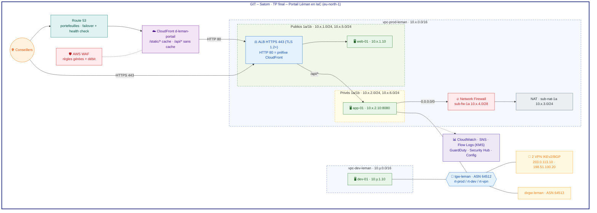

# Architecture du portail Léman (IaC)

## Vue d'ensemble

`x` vaut `20` en dev et `0` en prod ; `y` vaut `21` en dev et `1` en prod (voir [parameters/](../parameters)).

## Plan d'adressage (prod)

| Sous-réseau | CIDR | Zone | Rôle | Table |
|---|---|---|---|---|
| sub-public-1a | 10.0.1.0/24 | a | ALB, web-01 | rt-public → IGW |
| sub-prive-1a | 10.0.2.0/24 | a | app-01, attachement TGW | rt-prive → pare-feu |
| sub-nat-1a | 10.0.3.0/24 | a | NAT Gateway | rt-nat → IGW ; retour privés → pare-feu |
| sub-fw-1a | 10.0.4.0/28 | a | point de terminaison du pare-feu | rt-fw → NAT |
| sub-public-1b | 10.0.5.0/24 | b | ALB | rt-public → IGW |
| sub-prive-1b | 10.0.6.0/24 | b | attachement TGW | rt-prive → pare-feu |
| sub-dev-1a | 10.1.1.0/24 | a | dev-01 (VPC dev) | rt-dev → TGW (ou peering vers 10.0.2.0/24) |

## Chemins

| Flux | Chemin |
|---|---|
| Conseiller → portail | Route 53 → CloudFront (WAF) → ALB:80 (préfixe CloudFront) → web-01 / app-01 |
| app-01 → Internet | rt-prive → Network Firewall (liste de domaines) → NAT → IGW ; retour symétrique par rt-nat |
| dev-01 → app-01:8080 | TGW (`tgw-rt-dev`) ou peering ciblé (`ModeInterDev`) |
| Sites → prod | VPN (BGP) → `tgw-rt-vpn` → attachement prod ; préfixes des sites propagés dans `tgw-rt-prod` |
| Direct Connect | `dxgw-leman` associée à la TGW, préfixe annoncé limité au VPC de prod |

## Ordre des piles et dépendances

`00-socle` → `00b-budget` (us-east-1) → `01-reseau` → `02-securite` → `03-pare-feu` → `04-interconnexion` → `05-calcul` → `06a-waf` (us-east-1) → `06-edge-dns` → `07-supervision`

Les identifiants circulent par `Export` / `Fn::ImportValue` (préfixe `leman-<env>-<equipe>-`). La suppression se fait dans l'ordre inverse ([scripts/supprimer.sh](../scripts/supprimer.sh)).
